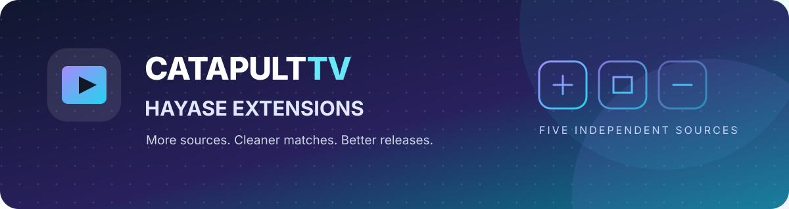

<p align="center">
  
</p>

<h1 align="center">CatapultTV · Hayase Extensions</h1>

<p align="center">
  <strong>More sources. Cleaner matches. Better releases.</strong><br>
  Independent, community-maintained torrent providers for <a href="https://hayase.watch">Hayase</a>.
</p>

<p align="center">
  
  
  
</p>

---

## Install

Add this repository manifest in **Hayase → Settings → Extensions → Repositories**:

```text
https://raw.githubusercontent.com/CatapultTV/Hayase-Extension/main/index.json
```

Each source is a separate extension, so you can enable only the providers you want.

## Sources

| Provider | What it is good at | Matching |
| --- | --- | --- |
| **SeaDex** | Curated, community-reviewed releases | AniList ID |
| **Nyaa** | Broad English-translated anime catalogue | Title + episode |
| **Sukebei Nyaa** | Additional catalogue coverage | Title + episode |
| **The Pirate Bay** | Supplemental search coverage | Title + episode |
| **SubsPlease** | Consistent weekly releases | Show title + exact episode |

## Better result matching

The search pipeline applies several checks before a torrent is returned:

- **Series title validation** — compares normalized Unicode title aliases against the release name, rather than trusting a site's search query alone.
- **Episode validation** — checks episode numbers at digit boundaries to avoid confusing episode 4 with episode 104.
- **Release-type filtering** — separates single episodes, season packs/batches and movies.
- **Resolution handling** — prefers the requested resolution when it is present in release metadata.
- **Exclusions** — removes releases containing keywords supplied by Hayase.
- **Hash deduplication** — collapses duplicate info hashes and keeps the strongest available metadata.
- **Quality-aware ranking** — curated best/alternative tags, accuracy, trusted-upload signals, remake flags, resolution, source/encode tags, seeders and upload date all contribute.

Accuracy labels are deliberately conservative: SeaDex uses AniList-ID matching; title-search providers are not labelled as perfect ID matches. A ranking score is not a guarantee that an encode is good or that its swarm is alive.

## Provider settings

### Nyaa and Sukebei

- Search up to **5, 10 or 20 pages** to reach older releases.
- Sort by **seeders** or **newest upload**.
- Choose the site's upload filter: all results, exclude remakes, or trusted uploaders only.
- Search supports title alternatives, episode, batch and movie modes.

### SeaDex

- Uses the releases.moe API with the AniList ID supplied by Hayase.
- Preserves manually curated **Best** and **Alternative** release types.
- Skips redacted/private hashes and validates available file metadata.
- Does not invent swarm statistics.

### SubsPlease

- Uses its catalogue API and validates the show title and exact episode.
- Selects the requested resolution when available, with a fallback to a supported resolution.
- Converts Base32 BitTorrent hashes to hexadecimal info hashes.
- Reports swarm statistics as unavailable rather than fabricating them.

### The Pirate Bay

- Uses the public apibay.org API.
- Normalizes info hashes, seeders, leechers, size and upload date.
- Provides supplementary title-search coverage; historical pagination is more limited than Nyaa.

## Icons

Provider icons are stored in this repository and served from stable raw GitHub URLs. This avoids depending on favicon paths controlled by external torrent sites.

## Limitations

- Title-based sources can still miss unusual release naming or aliases.
- Resolution and source tags are hints, not objective encode-quality measurements.
- Trusted/remake signals depend on the metadata exposed by the source site.
- Public tracker fallbacks can help peer discovery but cannot guarantee a healthy swarm.
- A listed torrent is not guaranteed to be downloadable or actively seeded.
- Provider outages, CORS restrictions and upstream changes can affect availability.
- AnimeTosho is not included: its operators announced that new torrents would stop being added in May 2026, so it would not be a dependable new provider.

## Development

Requires Node.js 20 or newer. No runtime dependencies.

```sh
npm run generate
npm run validate
npm test
```

Tests use mocked provider responses. They do not launch Hayase or repeatedly query live torrent sites.

## Repository layout

```text
.
├── assets/
│   ├── banner.svg
│   └── icons/
├── index.json
├── hayase/
│   ├── index.json
│   └── anime-torrents.js
├── tests/
│   └── extensions.test.js
├── generate_indexes.js
├── validate.js
└── package.json
```

## License

GPL-3.0. See [LICENSE](./LICENSE).
